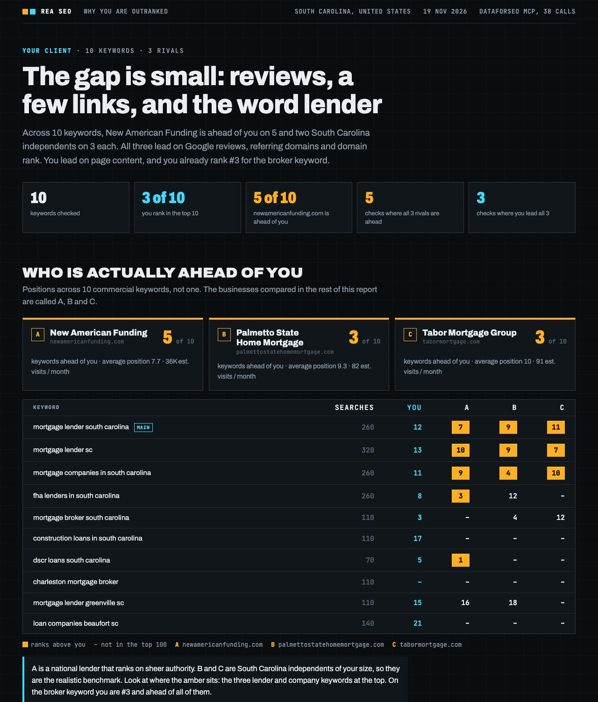

# REA SEO

Find out why a website is being outranked. REA SEO checks 5 to 10 keywords, finds the three businesses that beat the site most often, compares all four side by side, and writes a plan. Runs on the DataForSEO MCP connector: no API keys, no .env file.

A free skill for Claude Code. Inspired by [REA (Reverse Engineer Anything)](https://github.com/morluto/rea), not affiliated with it.



## Why this exists

REA can take any app apart and show you how it was built. Point it at a #1 ranking page and it gets some of it right: the title, the heading outline, the links. But it can't see most of what Google reads: schema, meta description, speed, backlinks, the rest of the site, or whether AI answers mention you.

REA SEO does that missing half with [DataForSEO](https://app.dataforseo.com/?aff=182182) data.

## What it does

1. **Finds the real rivals.** Positions across 5 to 10 commercial keywords, not one. The three businesses ahead of the site most often become A, B and C.
2. **Reads what Google wants.** The live results page for the main keyword, with every result labelled by page type (homepage, location page, directory, list article...).
3. **Compares Google Business Profiles.** Reviews, rating, categories, photos and who is in the map pack.
4. **Runs about 35 checks on all four sites** and sorts them: gaps all three rivals share, gaps most share, and things the site already leads on (ruled out).

| Area | Examples |
|---|---|
| Google Business Profile | Reviews, rating, categories, photos, services, in the map pack |
| Authority & brand | Linking sites (site and page), domain rank, domain age, brand searches, spam score |
| On-page SEO | Title, meta description, canonical, H1, schema, FAQ schema, image alt text |
| Content | Headings, keyword use, internal links |
| Pages & structure | Sitemap size, linked from the homepage |
| Agentic SEO / GEO | AI crawlers allowed, llms.txt, mentions in Google AI answers, named by ChatGPT |
| Speed | Lighthouse performance, largest paint, layout shift |

Every row is a difference between sites, not proof of why Google ranks one higher. Steal the strategy, never the content.

## Install

You need:
- **Claude desktop app** (Code tab) or Claude Code in the terminal
- The **DataForSEO connector** connected, with a few dollars of credit on your [DataForSEO account](https://app.dataforseo.com/?aff=182182)
- Python 3.9+

**Install the skill**, one of three ways:

1. **Easiest:** in the Claude desktop Code tab (or Claude Code), paste:
   > Install this skill: https://github.com/NicoSKOOL/rea-seo

2. **With git** (Mac / Linux; on Windows use `%USERPROFILE%\.claude\skills\rea-seo`):
   ```bash
   git clone https://github.com/NicoSKOOL/rea-seo ~/.claude/skills/rea-seo
   pip install -r ~/.claude/skills/rea-seo/requirements.txt
   ```

3. **As a zip:** download `rea-seo.zip` from the [latest release](https://github.com/NicoSKOOL/rea-seo/releases/latest) and upload it in Claude: Settings > Capabilities > Skills. Or unzip it so you get `~/.claude/skills/rea-seo/SKILL.md`, then run the `pip install` line above.

Restart Claude so it picks up the skill.

## Use

Open the Code tab in the folder you want the results saved in and ask:

> Use REA SEO: find out why mysite.com is being outranked

Or name the keywords you care about:

> Use REA SEO for mysite.com on "home appraiser virginia beach" and "appraisal company norfolk"

It checks the DataForSEO connector is there, tells you the cost before it spends anything, and 5 to 10 minutes later you get the report as an artifact (or it opens in your browser).

## What you get

The report as a Claude artifact, plus everything saved in `rea-seo/<site>/package/` (and a zip of it):

| File | Use it to |
|---|---|
| `report.html` | See the full comparison and the plan |
| `ACTION_PLAN.md` | Work through the plan as a checklist |
| `data/keywords.csv` | Positions for every keyword, you and each rival |
| `data/scores.csv` | Every check, you and each rival |
| `data/page_one.csv`, `data/gbp.csv` | The results page with page types, and the Business Profile comparison |
| `data/link_gap.csv` | Sites linking to all rivals but not to you |
| `data/baseline.json` | Today's numbers, so you can measure progress later |

Then drag the package folder into Claude or ChatGPT and say: *work through ACTION_PLAN.md one step at a time.*

## Good to know

- **Cost:** about $1 to $2 of DataForSEO credit per run, 35 to 40 MCP calls. The exact cost is in your DataForSEO dashboard.
- **Any country:** any DataForSEO location name (United States, United Kingdom, Australia, Canada...).
- **Small markets:** DataForSEO traffic estimates are thin for small non-English markets. SERP and backlink data stay solid.
- **No rankings promised.** It shows you the gap and a plan. Closing gaps like backlinks and brand still takes real work.

## Part of AI Ranking

This is one of the free tools from **AI Ranking**, the community where we learn how to get businesses found on Google and recommended by AI (ChatGPT, Google AI Overviews, Perplexity).

**Free community:** [skool.com/ai-ranking-free](https://skool.com/ai-ranking-free)  
Every free skill in one place, with setup guides.

**Premium:** [skool.com/ai-ranking](https://skool.com/ai-ranking)  
For when you want help, not just tools:
- Support when a skill or a site gets stuck
- 1-1 sessions
- Live Q&A calls
- The full training on how to rank in AI search

Built by [Nico Gorrono](https://airankingskool.com/about/)
